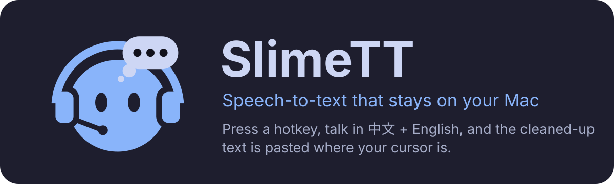
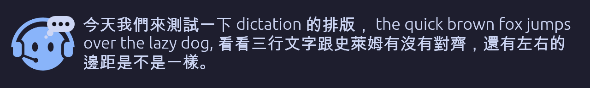

<p align="center"></p>

# SlimeTT (STT)

SlimeTT is a dictation app for macOS. Tap a hotkey, talk in Traditional Chinese, English, or both mixed in one sentence, tap again, and the text is pasted into whatever app you were typing in.

Speech recognition runs inside the app, on your Mac. Nothing you say leaves the machine.

<p align="center"></p>

## What it does

- **Live text.** Your words appear in a small floating popup as you speak.
- **Mixed languages.** 中文 and English in the same sentence; Chinese is written in Traditional characters with Taiwan vocabulary.
- **Cleanup (optional).** After you stop, a language model adds punctuation, applies spoken corrections ("八點，不對，九點"), and writes numbers as digits. It uses Apple's on-device model, or any OpenAI-compatible server you point it at.
- **Edit before pasting.** The cursor sits at the end of the text, so Backspace and typing work straight away.
- **Learns your words.** Fix a misheard name in the popup and SlimeTT remembers the swap once it looks like a real mishearing rather than a one-off edit.
- **Stays out of your clipboard history.** Pastes are flagged as temporary, so clipboard managers skip them, and your previous copy is put back.

## Requirements

- A Mac with Apple Silicon
- macOS 14 or later
- For the built-in cleanup: macOS 26 with Apple Intelligence turned on. Without it, dictation still works and cleanup is skipped, or you can use your own endpoint.

## Install

There are no pre-built downloads yet, so build it from source. You need [Rust](https://rustup.rs) and the Xcode command line tools (`xcode-select --install`).

```sh
git clone https://github.com/MarkymarkLee/SlimeTT.git
cd SlimeTT
./bundle.sh --install
```

This builds `SlimeTT.app`, signs it with a local certificate it creates on first run, copies it to `/Applications` and launches it. Use `./bundle.sh` without `--install` to build only; the app is left in `target/release/SlimeTT.app`.

On first launch SlimeTT:

1. Asks for **Microphone** access, so it can hear you.
2. Asks for **Accessibility** access, so the hotkey works in every app and the text can be pasted at your cursor. It restarts itself once after you grant this.
3. Downloads the speech model (about 130 MB) to `~/Library/Application Support/stt/models/`.

## Using it

| Do this | What happens |
|---|---|
| Tap **Right Option** (the default hotkey) | The popup opens and recording starts |
| Tap the hotkey again, or press **Enter** | Recording stops, the text is cleaned up and pasted |
| **Shift+Enter** | New line in the popup |
| **Esc** | Cancel, nothing is pasted |
| Say "undo" / "復原" | Removes the last thing you said |
| Say "clear" / "清除" | Empties the popup |

While the cleanup is running, the slime picks up a pencil.

Settings are in the menu bar (the slime icon): hotkeys, speech model, microphone, Traditional Chinese variant, popup position, sounds, cleanup provider, and your vocabulary list.

## Privacy

- Audio is processed on your Mac and is never saved or uploaded.
- The only network use is downloading speech models from the [sherpa-onnx releases](https://github.com/k2-fsa/sherpa-onnx/releases), and the cleanup endpoint if you configure a remote one. The default cleanup (Apple's on-device model) stays local.
- Settings, vocabulary and models live in `~/Library/Application Support/stt/`. A crash log, if there is one, is at `~/Library/Logs/stt.log`.

## Development

```sh
tests/check.sh                   # everything below in one go: format check, lints, unit tests
cargo test                       # unit tests only
cargo clippy --all-targets       # lints; the tree is kept warning-free
cargo fmt                        # formatting (see rustfmt.toml)
target/release/stt --transcribe some16k.wav   # run the speech model on a 16 kHz WAV, no UI
```

Layout check without touching the screen: the app can render its own popup to an image and exit.

```sh
STT_SHOT=/tmp/popup.bmp DYLD_LIBRARY_PATH=vendor/sherpa-onnx/lib target/debug/stt
```

Set `STT_SHOT_MOOD` to `write`, `error` or `status` for the other states.

- `src/` — the app: `main.rs` (UI and flow), `engine.rs` (audio → text), `asr.rs` (speech models), `llm.rs` (cleanup), `vocab.rs` (learned words), `macos.rs` (system glue), `theme.rs` (Catppuccin Mocha colours).
- `assets/` — the slime icon, the cleanup prompts, README images.
- `tests/` — the unit tests, one file per source module (`text`, `vocab`, `macos`, `blob`), and `check.sh`. Each file is compiled as part of its module, so it can test private functions.
- `vendor/sherpa-onnx/` — pre-built sherpa-onnx and ONNX Runtime libraries (arm64) and the C header the bindings are generated from.

## Credits and licence

SlimeTT is released under the [MIT licence](LICENSE).

It builds on [sherpa-onnx](https://github.com/k2-fsa/sherpa-onnx) (Apache-2.0) and [ONNX Runtime](https://github.com/microsoft/onnxruntime) (MIT) for speech recognition, [egui](https://github.com/emilk/egui) for the interface, [OpenCC](https://github.com/BYVoid/OpenCC) data for Traditional Chinese conversion, and the [Catppuccin](https://catppuccin.com) Mocha palette. The speech models are downloaded separately and carry their own licences.
